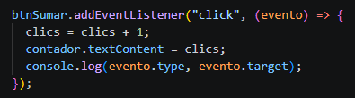
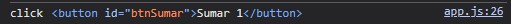

# Bitacora de JavaScript interactivo
 
Laboratorio 08: JavaScript Interactivo - DOM, Eventos y Objetos.

Navegador usado: **Brave**
 
## Ejercicio 2: Seleccionar y modificar el DOM

| Instrucción | Que cambio en la pantalla | Se mantiene al recargar (Si/No) |
|-------------|---------------------------|---------------------------------|
| textContent desde app.js | Sé cambio el titulo por "Hola TECSUP" | Si |
| style.color | Cambio el color del título a "blue"| Si |

## Ejercicio 3: Evento click
 
| Tipo de evento | Que acción lo dispara | Cuánto suma por acción |
|----------------|-----------------------|------------------------|
| click | Suma con cada click | Suma 1 click por acción |
| dblclick | Suma con cada doble click | Suma 1 click por acción |
| mouseover | Suma al pasar el curso sobre el botón "Sumar 1" | Suma 1 click por acción |

```js
En una parte del archivo "app.js" tenemos está linea: console.log(evento.type, evento.target);
```



Mostrandosé en la consola de está manera



```html
Donde "evento.type" indica el tipo de evento que se ejecuto, llamado "click" y "evento.target" nos muestra la referencia al elemento HTML (<button id="btnSumar">Sumar 1</button>) donde se originó el evento.
```

## Ejercicio 4: Eventos input y submit

| Prueba | Que paso en la pantalla | Se recargo la página (Si/No) |
|--------|-------------------------|------------------------------|
| Escribir en el campo nombre | Grabo el nombre que ingresado | No |
| Enviar sin preventDefault | Al ingresa el correo y darle al botón "Enviar", el correo se borra | Si |
| Enviar con preventDefault, correo sin @ | No deja guardar y pide que el "@" | No |
| Enviar con preventDefault, correo con @ | El correo se guarda correctamente | No |

## Ejercicio 5: Clases y objetos

| Objeto | nombre | precio | conDescuento(0.25) |
|--------|--------|--------|--------------------|
| laptop | Laptop | S/ 2500.00 | S/ 1875.00 |
| mouse | Mouse | S/ 45.00 | S/ 33.75 |
| teclado | Teclado | S/ 120.00 | S/ 90.00 |
| monitor | Monitor | S/ 680.00 | S/ 510.00 |

La ventaja que nos da usar una "Clase Producto" en JavaScript, en lugar de escribir cada producto en HTML, está en que podemos usar metodos que se consulten con los productos añadidos y sus valores.