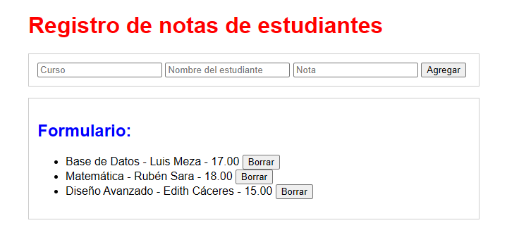

# Tarea: Mi componente interactivo

## Componente elegido

Registro de Notas de Estudiantes

## Código principal

```js
class RegistroNota {
    constructor(curso, nombre, nota) {
        this.curso = curso;
        this.nombre = nombre;
        this.nota = Number(nota);
    }

    mostrarRegistro(){
        return `${this.curso} -  ${this.nombre} - ${this.nota.toFixed(2)}`;
    }

    crearElementoHTML() {
        const li = document.createElement("li");

        li.textContent = this.mostrarRegistro() + " ";

        const btnBorrar = document.createElement("button");
        btnBorrar.textContent = "Borrar";

        btnBorrar.addEventListener("click", () => {
         li.remove();
        });

        li.appendChild(btnBorrar);
        return li
    }
}

const formulario = document.getElementById("formulario-notas");
const listaNotas = document.getElementById("lista-notas");

formulario.addEventListener("submit", (evento) => {
    evento.preventDefault();

    const curso = document.getElementById("curso").value;
    const nombre = document.getElementById("nombre").value;
    const nota = document.getElementById("nota").value;

    const nuevoRegistro = new RegistroNota(curso, nombre, nota);
    const elementoDOM = nuevoRegistro.crearElementoHTML();

    listaNotas.appendChild(elementoDOM);

    formulario.reset();
});
```


 
## Pruebas realizadas

| Acción | Resultado esperado | Cumple (Si/No) |
|--------|--------------------|----------------|
| Agregar | Al llenar las casillas, los datos se guardan al hacer click a "Agregar" sin que la página se recargue | Si |
| Borrar | Cada dato registrado tiene la opción de "Borrar", al darle click se elimina dicho dato. | Si |
 
## Por que diseñe así mi clase

Diseñe la **Clase RegistroNota** separando los datos, mostrando los datos y la creación del elemento en el DOM para que cada parte tenga una responsabilidad clara:

- **constructor(curso, nombre, nota):** Para guardar los datos de cada registro, convertimos "nota" a número (Number(nota)), así evitamos errores al ingresar otro tipo de datos.

- **mostrarRegistro():** ES como se presenta la información como texto.

- **crearElementoHTML():** Encapsula la creación del "li" y su botón "Borrar" con **decument.createElement**, además de asociar el evento "click" a ese elemento antes de devolverlo. Esto permite que cada fila se elimine de forma independiente con **li.remove()**.